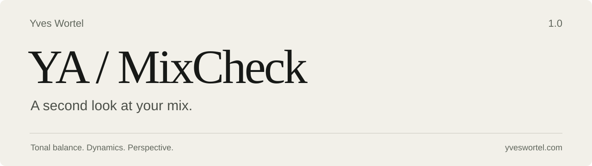
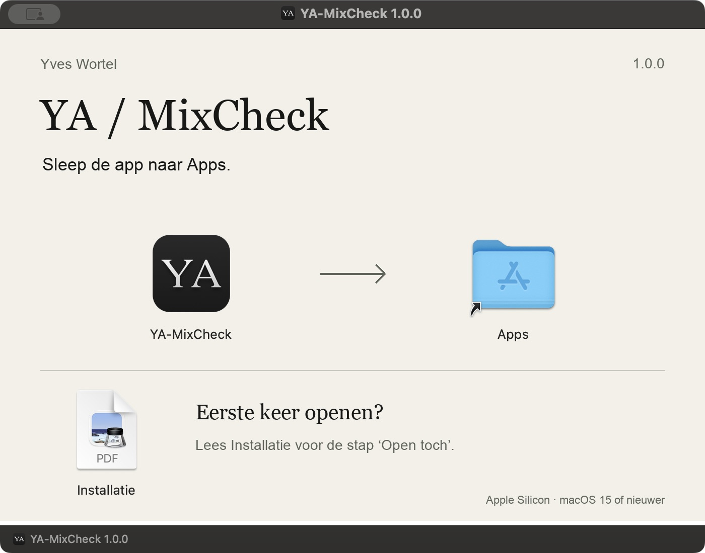

<p align="center"><a href="README.md">Nederlands</a> · <strong>English</strong></p>

<p align="center">
  
</p>

<p align="center">
  <strong>macOS 15+ &nbsp; / &nbsp; Apple Silicon &nbsp; / &nbsp; Version 1.0</strong><br>
  WAV · AIFF · FLAC · MP3
</p>

<p align="center">
  <a href="https://github.com/yveswortel/ya-mixcheck/releases/download/v1.0.0/YA-MixCheck-1.0.0-arm64.dmg"><strong>Download for Mac</strong></a>
  &nbsp; · &nbsp;
  <a href="https://github.com/yveswortel/ya-mixcheck/releases/tag/v1.0.0">Release notes</a>
  &nbsp; · &nbsp;
  <a href="https://yveswortel.com">Yves Wortel</a>
</p>

---

## Fresh perspective, informed questions

After a long mixing session, it can be hard to hear your work objectively.
YA-MixCheck gives you a second look at your export: tonal balance, dynamics and
technical observations, distilled into up to three focused listening suggestions.

Drop a file into the app, choose a genre and decide what to do with the findings.
Analysis runs locally on your Mac and leaves the original audio file unchanged.

## What you can check

| Area | What it shows |
| :--- | :--- |
| **Tonal balance** | Sub, Bass, Low-mid, Body, Mids, High and Air against a small genre reference collection. |
| **Dynamics** | Density, punch and movement across the whole track. |
| **Loudness & peaks** | LUFS, LRA, sample peak and, where supported, estimated true peak. |
| **Stereo & technical checks** | Correlation, mono energy, channel balance and possible clicks, dropouts and clipping. |
| **Listening suggestions** | Combined observations that distinguish local from persistent deviations. |
| **Comparison** | Reference A/B and a temporary EQ preview, with level matching. |
| **Reports** | A readable HTML report, JSON measurements and CSV markers. |

A deviation is not automatically a fault. A loud master, deep bass or wide stereo
image can be an intentional choice. Measurements support your ears; they do not
decide how your music should sound.

## Installation

1. [Download the DMG](https://github.com/yveswortel/ya-mixcheck/releases/download/v1.0.0/YA-MixCheck-1.0.0-arm64.dmg) and open it.
2. Drag **YA-MixCheck** to **Applications** (the folder shortcut is labelled **Apps**).
3. Open the app from **Applications**.

This version is not notarized by Apple. If macOS blocks the first launch, attempt
to open the app, then go to **System Settings → Privacy & Security → Open Anyway**
and confirm with **Open**. Only do this for the package obtained from this
repository or directly from Yves.

An [English installation guide](Assets/Installer/Installation.en.pdf) is available
separately and attached to the release. The original DMG contains the Dutch guide.
You do not need Homebrew, Java or Xcode to use the app.

**Language:** GitHub documentation is available in Dutch and English. The 1.0 app
interface, its advice and exported reports are currently in Dutch. English app
support is not part of this documentation update.

<details>
<summary>View the installation window (Dutch)</summary>



</details>

## What 1.0 does and does not promise

The reference collection is still a pilot. Genre ranges provide context, not an
ideal curve for every track. Click, dropout and clipping flags are candidates for
listening checks; the app cannot determine artistic intent.

The measurement engine passed the applicable official EBU minimum tests at
**48 kHz, mono/stereo**. This is not certification across all sample rates. At
**192 kHz and above**, the app reports sample peak only. For the first testing
round, use audio that is fully available locally; the complete iCloud failure
matrix has not yet been signed off.

Advice quality will be assessed further with testers. Reopening saved sessions,
24-bit WAV export and an Audio Unit version are not features of 1.0.

[Test coverage and known limits](docs/VALIDATION.en.md) · [Changelog](CHANGELOG.en.md)

## Build from source

On an Apple Silicon Mac with macOS 15+, Xcode Command Line Tools and Python 3:

```sh
bash scripts/build.sh
build/YA-MixCheck.app/Contents/MacOS/YA-MixCheck --self-test
bash scripts/package.sh
```

The app uses Swift, C and Apple frameworks. Third-party components are included;
a JUCE installation is not required. See the [build and packaging guide](docs/BUILD.en.md).

## Feedback

Open an [issue](https://github.com/yveswortel/ya-mixcheck/issues) with your macOS
version, app version, file format and steps to reproduce the problem. For advice
that seems wrong, include the selected genre. Only upload audio you are allowed
to share. Feedback is welcome in Dutch or English.

---

**Yves Audio / Yves Wortel** · [yveswortel.com](https://yveswortel.com)

Credits: [libebur128](Vendor/COPYING), [minimp3](Vendor/minimp3/LICENSE) and
[dr_flac](Vendor/dr_libs/LICENSE). The app icon uses Rosemartin by Eko Bimantara;
the original [font terms](Assets/Fonts/Rosemartin/LICENSE.txt) are included.
No general open-source licence has currently been granted for the project's own code.
