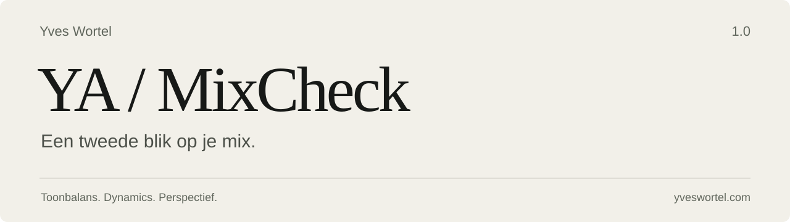

<p align="center">
  
</p>

<p align="center">
  <strong>macOS 15+ &nbsp; / &nbsp; Apple Silicon &nbsp; / &nbsp; Versie 1.0</strong><br>
  WAV · AIFF · FLAC · MP3
</p>

<p align="center">
  <a href="https://github.com/yveswortel/ya-mixcheck/releases/download/v1.0.0/YA-MixCheck-1.0.0-arm64.dmg"><strong>Download voor Mac</strong></a>
  &nbsp; · &nbsp;
  <a href="https://github.com/yveswortel/ya-mixcheck/releases/tag/v1.0.0">Release notes</a>
  &nbsp; · &nbsp;
  <a href="https://yveswortel.com">Yves Wortel</a>
</p>

---

## Frisse oren, onderbouwde vragen

Na een lange mixsessie is afstand nemen lastig. YA-MixCheck geeft je een tweede
blik op je export: toonbalans, dynamics en technische signalen, vertaald naar
maximaal drie concrete luisteradviezen.

Sleep je bestand in de app, kies een genre en bepaal zelf wat je met de bevindingen
doet. De app analyseert lokaal en laat het originele audiobestand ongewijzigd.

## Wat je kunt checken

| Onderdeel | Wat het je laat zien |
| :--- | :--- |
| **Toonbalans** | Sub, Bass, Low-mid, Body, Mids, High en Air tegenover een compacte genrereferentie. |
| **Dynamics** | Dichtheid, punch en beweging over de hele track. |
| **Luidheid & pieken** | LUFS, LRA, samplepeak en — waar ondersteund — geschatte true peak. |
| **Stereo & techniek** | Correlatie, mono-energie, kanaalbalans en mogelijke kliks, dropouts en clipping. |
| **Luisteradvies** | Combinaties van metingen, met onderscheid tussen lokale en aanhoudende afwijkingen. |
| **Vergelijken** | Referentie A/B en tijdelijke EQ-preview, met niveaumatching. |
| **Rapportage** | Een leesbaar HTML-rapport, JSON-metingen en CSV-markers. |

Een afwijking is geen automatische fout. Een luide master, diepe bas of brede
stereo kan een bewuste keuze zijn. Meetwaarden ondersteunen je oren; ze bepalen
niet hoe je muziek moet klinken.

## Installeren

1. [Download de DMG](https://github.com/yveswortel/ya-mixcheck/releases/download/v1.0.0/YA-MixCheck-1.0.0-arm64.dmg) en open hem.
2. Sleep **YA-MixCheck** naar **Apps**.
3. Open de app vanuit **Apps**.

Deze versie is niet door Apple genotariseerd. Blokkeert macOS de eerste start?
Ga na je openingspoging naar **Systeeminstellingen → Privacy en beveiliging →
Open toch**, en bevestig met **Open**. Gebruik alleen het pakket dat je via deze
repository of rechtstreeks van Yves hebt ontvangen.

De korte [installatiehandleiding](Assets/Installer/Installatie.pdf) zit ook in de
DMG. Je hebt geen Homebrew, Java of Xcode nodig om de app te gebruiken.

<details>
<summary>Bekijk het installatievenster</summary>


</details>

## Wat 1.0 wel en niet belooft

De referentiecollectie is nog een pilot. Genrebanden zijn context, geen ideale
curve voor elk nummer. Klik-, dropout- en clippingmeldingen zijn luisterkandidaten;
de app kan de artistieke intentie niet vaststellen.

De meetkern doorstond de toepasselijke officiële EBU-minimumtests op **48 kHz,
mono/stereo**. Dat is geen certificering voor alle samplefrequenties. Vanaf
**192 kHz** toont de app alleen samplepeak. Gebruik voor de eerste testronde
bij voorkeur volledig lokaal beschikbare audio; de volledige iCloud-foutmatrix
is nog niet afgetekend.

Advieskwaliteit wordt met testers verder beoordeeld. Sessies heropenen,
24-bit WAV-export en een Audio Unit-versie zijn geen functies van 1.0.

[Testresultaten en bekende grenzen](docs/VALIDATION.md) · [Wijzigingen](CHANGELOG.md)

## Zelf bouwen

Op een Apple Silicon-Mac met macOS 15+, Xcode Command Line Tools en Python 3:

```sh
bash scripts/build.sh
build/YA-MixCheck.app/Contents/MacOS/YA-MixCheck --self-test
bash scripts/package.sh
```

De meetkern gebruikt Swift, C en Apple-frameworks. Externe componenten zijn
meegeleverd; een JUCE-installatie is niet nodig. Zie [bouw- en verpakkingsinstructies](docs/BUILD.md).

## Feedback

Maak een [issue](https://github.com/yveswortel/ya-mixcheck/issues) met je macOS-versie,
appversie, bestandsformaat en de stappen om het probleem te herhalen. Deel bij
verkeerd advies ook de gekozen genrecontext. Upload alleen audio die je mag delen.

---

**Yves Audio / Yves Wortel** · [yveswortel.com](https://yveswortel.com)

Credits: [libebur128](Vendor/COPYING), [minimp3](Vendor/minimp3/LICENSE) en
[dr_flac](Vendor/dr_libs/LICENSE). Het app-icoon gebruikt Rosemartin van Eko Bimantara;
de [fontvoorwaarden](Assets/Fonts/Rosemartin/LICENSE.txt) zijn meegeleverd.
Voor de eigen projectcode is momenteel geen algemene open-sourcelicentie toegekend.
